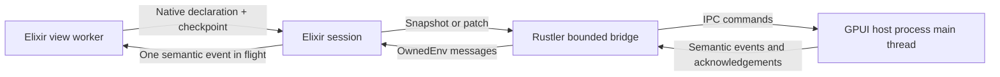

# live_gpui

**Elixir owns the application. GPUI owns the interaction. Rustler connects them.**

A native desktop target with familiar LiveView callbacks, a Phoenix socket, and an explicit `~G` template language. It renders GPUI elements, not HTML. This is callback compatibility, **not** a Phoenix channel, HEEx renderer, or adapter for Phoenix's browser diff protocol. Arbitrary web LiveViews do not run unchanged.

## Run the proof

Requires Elixir 1.20, OTP 28, Rust, and a working desktop display. Development is verified on x86-64 GNU/Linux/X11 using Rust 1.97 and Mesa Lavapipe. macOS and Windows are not runtime-validated here; the separate host executable owns its process main thread on every platform.

Typical Ubuntu source-build prerequisites:

```sh
sudo apt-get install build-essential pkg-config libfontconfig1-dev libfreetype-dev \
  libxkbcommon-x11-dev libwayland-dev libvulkan-dev mesa-vulkan-drivers
mix deps.get
mix run --no-halt -e '{:ok, _} = LiveGPUI.open(LiveGPUI.Demo)'
```

Mix builds both the Rustler library and `live_gpui_host`, placing them in `priv/native`. The current development builds use Cargo's debug profile with debug information disabled.

The demo has a single-line text editor, a keyed list of editors, reorder/add/remove actions, a five-second CPU-bound Elixir callback, and a view-restart action. Static text and action rows wrap to the available width; single-line editors clip and scroll horizontally to keep the caret visible.

## A native view

```elixir
defmodule Counter do
  use LiveGPUI.View

  def mount(_params, _session, socket) do
    {:ok, assign(socket, count: 0)}
  end

  def render(assigns) do
    ~G"""
    <column gap={12}>
      <text id="count">Count: {@count}</text>
      <button id="increment" phx-click="increment">Increment</button>
    </column>
    """
  end

  def handle_event("increment", _params, socket) do
    {:noreply, update(socket, :count, &(&1 + 1))}
  end
end

{:ok, session} = LiveGPUI.open(Counter)
```

`mount/3` returns `{:ok, socket}`. `render/1` returns a `LiveGPUI.Node`. `handle_event/3`, and optional `handle_info/2`, return `{:noreply, socket}`. `assign/2`, `assign/3`, and `update/3` are Phoenix helpers. Lifecycle options, hooks, components, routing, streams, and web-specific LiveView APIs are not part of this native contract.

### Supported templates

| Tag | Properties | Children |
| --- | --- | --- |
| `column`, `row`, `list` | `id`, integer `gap` from 0 to 128 | Native nodes |
| `text` | `id`, `text` | Scalar text interpolation |
| `button` | `id`, `text`, `phx-click`, scalar `phx-value-*` | Scalar text interpolation |
| `input` | `id`, `value`, `placeholder`, `edit_revision`, `phx-change`, scalar `phx-value-*` | Self-closing only |

Brace expressions compile in the caller's Elixir context; `@name` reads an assign. Nested `:if={...}` and `:for={item <- @items}` are supported. A repeated node must have an explicit, nonempty, globally unique stable ID. One unconditional root is required. Unsupported tags, attributes, and malformed templates fail rather than rendering a web fallback.

Static IDs can be omitted: the root defaults to `"root"`, and descendants derive IDs from their parent ID and child index. Use explicit IDs for controls whose identity must survive structural changes. `list` is an ordered keyed container, not a virtualized collection.

### Revisioned text edits

```elixir
# In render/1:
~G"""
<input id="draft" value={@draft} edit_revision={@draft_revision}
  placeholder="Write something" phx-change="edit" />
"""

# In handle_event/3:
def handle_event("edit", %{"value" => value, "edit_revision" => revision}, socket) do
  {:noreply, assign(socket, draft: value, draft_revision: revision)}
end
```

Initialize both assigns in `mount/3`. An edit carries the complete provisional value and a monotonically increasing native edit revision. Echo that revision when accepting or transforming the value. Older acknowledgements cannot overwrite newer native edits. Equal-value acknowledgements preserve selection and composition. Application transformations arriving during composition are deferred until composition ends, unless superseded by a newer edit.

GPUI handles UTF-16 platform composition ranges, selection, grapheme navigation, mouse selection, and clipboard interaction locally. Caret motion does not generate an application event. The view receives semantic value changes, not frame instructions.

## Ownership and recovery



The session outlives its view worker and owns the native resource. After a worker crash, it remounts, restores the last successfully rendered assigns over mount defaults, increments the generation, and sends a full snapshot to the existing window. Surviving controls retain actual GPUI entity identity. Pending local edits are re-emitted in the new generation rather than being overwritten by an older checkpoint. This is in-memory recovery; closing the session or restarting the application does not persist domain state.

The internal newline-delimited JSON protocol has explicit rules:

- A snapshot establishes a positive generation and revision and a complete stable-ID tree.
- A patch requires the exact generation and base revision, and advances by one revision.
- Invalid topology is rejected atomically. A mismatch requests a fresh snapshot.
- Elixir sends one update at a time and diffs from the last acknowledged tree. It retains the latest desired declaration while waiting; it does not drop a dependent patch and continue its successors.
- Queue pressure triggers snapshot recovery. Bridge and host command queues hold eight messages each. Native output and pending semantic events are bounded at 64. Adjacent edits to one control coalesce to their latest complete value without crossing an intervening action.
- Discrete-event overflow terminates the session explicitly instead of silently losing actions. Native output overflow terminates the host instead of blocking interaction or silently losing protocol messages.
- Messages are limited to 1 MiB; trees to 4,096 nodes and 64 levels. Native IDs are limited to 1,024 bytes.

Only validated commands and ordinary data cross threads. GPUI's `App`, entities, and foreground executor remain in the host process; there is no UI loop inside a dirty NIF. `open`/`close` use dirty I/O scheduling for process operations. `submit` validates and enqueues without waiting for a frame or an Elixir callback.

### Session API

- `LiveGPUI.open(view, options \\ [])`: starts a session; options include `:params`, `:session`, `:name`, and a custom `:host` executable path. Window startup and initial snapshot application are asynchronous.
- `LiveGPUI.view_pid(session)`: current view worker, independent of callback responsiveness.
- `LiveGPUI.restart_view(session)`: replaces the worker and restores its checkpoint through a new generation.
- `LiveGPUI.inspect_native(session, timeout \\ 5000)`: returns `{:ok, inspection}` with actual native entity IDs, input values, UTF-16 selections, composition ranges, child order, generation, and applied revision. During startup, revision may still be zero.
- `LiveGPUI.close(session)`: closes the window and worker.

## Native dependencies

GPUI is pinned to `0.2.2`. Two dependency constraints are deliberate:

- `libc 0.2.186` retains the Linux alias required by GPUI's transitive `xattr 0.2.3` dependency.
- `native/vendor/zed-xim` retains the MIT-licensed `zed-xim 0.4.0-zed` implementation while upgrading its compound-text decoder to `xim-ctext 0.4.1`. The older decoder rejects valid Chinese XIM preedit data and crashes the host. The vendored manifest records its source revision; local source changes make builder lifetimes explicit and propagate reset errors.

## Validation

```sh
mix ci
cargo fmt --all --check
cargo clippy --workspace --all-targets -- -D warnings
cargo test --workspace
cargo test -p xim-ctext
```

The Elixir suite covers native compilation, keyed tree transitions, and bounded event ordering. Native tests cover atomic protocol recovery, topology/payload boundaries, Unicode text coordinates, and composition-preserving reconciliation. Actual desktop validation additionally exercises native typing during a CPU-bound view callback, real X11/IBus composition, keyed reordering, view-process recovery, mismatch recovery, and resized wrapping; unit tests alone do not establish desktop behavior.

## References

- [GPUI](https://gpui.rs) and its [Taffy layout engine](https://docs.rs/crate/gpui/0.2.2/source/src/taffy.rs).
- [Rustler OwnedEnv](https://docs.rs/rustler/0.38.0/rustler/env/struct.OwnedEnv.html) for asynchronous native-thread messaging.
- [Phoenix LiveView's template engine](https://hexdocs.pm/phoenix_live_view/Phoenix.LiveView.Engine.html): its rendered/diff contract is not a native control tree.
- [elixir-crab/gpui](https://github.com/elixir-crab/gpui): relevant prior art, not an API or implementation dependency of this project.
